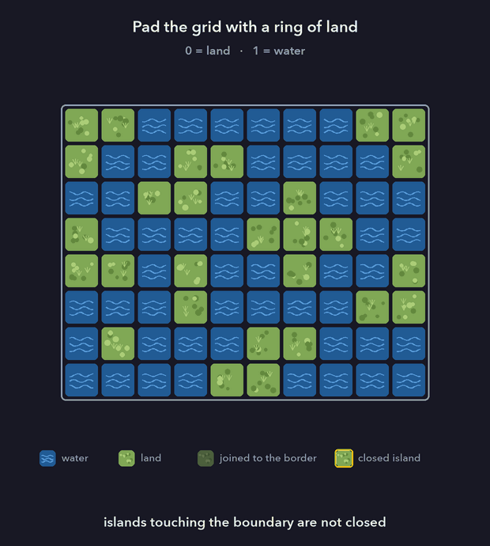
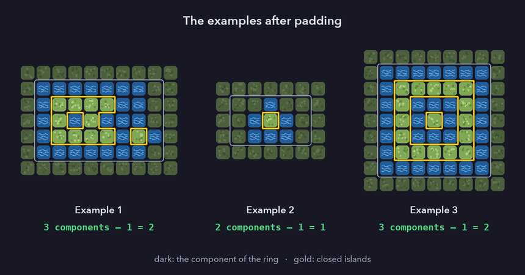
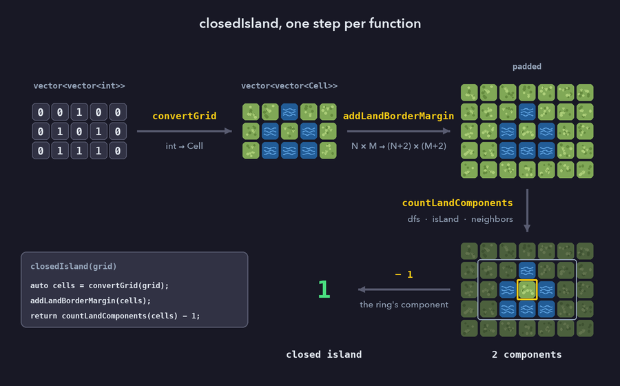

# Intuition
The algorithm is nothing special. The only idea is to add one layer of land around the whole map. Every island that is not closed then merges with this layer into a single component, so the answer is the number of land components minus one.

# Approach
Islands are the connected components of the land cells, so it is natural to view the grid as a graph: the vertices are the land cells, and two land cells are adjacent if they share a side.

### 1. Closed islands

**Lemma 1.** An island $I$ is closed if and only if no cell of $I$ lies on the boundary of the grid.

*Proof.* Take a cell of $I$ and one of its four neighbours $p$. If $p$ is inside the grid, then $p$ is either water or in $I$, because an island is maximal. So a cell of $I$ can fail to be surrounded by water only through a neighbour that lies outside the grid, which means the cell is on the boundary. $\blacksquare$

### 2. Padding with land

Let $G'$ be the $(N+2) \times (M+2)$ grid obtained by adding a ring $R$ of land cells around the grid.

**Lemma 2.** The land components of $G'$ are exactly
- one component $C_0$, made of $R$ together with every island that is not closed, and
- every closed island, unchanged.

*Proof.* $R$ is connected, since it is a cycle of cells. An island that is not closed has a cell on the boundary of the grid (Lemma 1), and that cell is adjacent to a cell of $R$, so the island lies in the component of $R$. A closed island $I$ has no cell on the boundary, so every neighbour of a cell of $I$ lies inside the original grid, where it is water or in $I$. The ring gives $I$ no new neighbours, so $I$ is still a component. Every land cell of $G'$ is in $R$ or in some island, so there are no other components. $\blacksquare$

**Theorem.** The number of closed islands equals the number of land components of $G'$ minus one.



### 3. Counting the components

Any graph traversal counts the components: DFS, BFS, or a DSU over adjacent land cells. The code scans $G'$ row by row and starts a DFS from every land cell that is not yet visited. Each start is a new component. The first start is the corner $(0, 0)$, which lies on $R$, so the component removed by the $-1$ is the first one found.



On the given examples:
- Example 1: $C_0$ plus two closed islands, $3 - 1 = 2$.
- Example 2: $C_0$ plus the single centre cell, $2 - 1 = 1$.
- Example 3: $C_0$ plus the square ring and the cell inside it, $3 - 1 = 2$.

### Edge case ⚠️
If no island touches the boundary, as in Example 3, the ring $R$ is still a component of its own. So the $-1$ is correct even when there is nothing to merge.

# Complexity
- Time complexity: $$O(N \cdot M)$$
converting and padding the grid are linear, and the DFS visits each cell once and looks at 4 neighbours.
- Space complexity: $$O(N \cdot M)$$
for the padded copy, `mark`, and the recursion stack, which can be as deep as the number of land cells.

# Code
```cpp
class Solution {
private:
    enum class Cell {
        Land,
        Water
    };

    static constexpr pair<int, int> neighbors[] = {
        {-1, 0},
        {1, 0},
        {0, -1},
        {0, 1}
    };

public:
    int closedIsland(vector<vector<int>>& grid) {
        auto cells = convertGrid(grid);
        addLandBorderMargin(cells);

        // the ring of land and every island touching the boundary
        // form one component; every other component is a closed island
        return countLandComponents(cells) - 1;
    }

private:
    vector<vector<Cell>> convertGrid(const vector<vector<int>>& grid) {
        vector<vector<Cell>> cells;
        cells.reserve(grid.size());

        for (const auto& row : grid) {
            vector<Cell> convertedRow;
            convertedRow.reserve(row.size());

            for (int cell : row) {
                convertedRow.push_back(
                    cell == 0 ? Cell::Land : Cell::Water
                );
            }

            cells.push_back(move(convertedRow));
        }

        return cells;
    }

    /**
     * Turn an NxM grid into an (N+2)x(M+2) grid
     * by adding 2 rows and 2 columns of land (L) around it
     *
     * for example :
     *                      LLLLL
     *        XXX           LXXXL
     *        XXX     -->   LXXXL
     *        XXX           LXXXL
     *        XXX           LXXXL
     *                      LLLLL
    */
    void addLandBorderMargin(vector<vector<Cell>>& grid) {
        int m = grid[0].size();

        grid.insert(
            grid.begin(),
            vector<Cell>(m, Cell::Land)
        );
        grid.push_back(vector<Cell>(m, Cell::Land));

        for (auto& row : grid) {
            row.insert(row.begin(), Cell::Land);
            row.push_back(Cell::Land);
        }
    }

    int countLandComponents(
        const vector<vector<Cell>>& grid
    ) {
        int n = grid.size();
        int m = grid[0].size();

        vector<vector<bool>> mark(n, vector<bool>(m, false));
        int cntComponents = 0;

        for (int i = 0; i < n; i++) {
            for (int j = 0; j < m; j++) {
                if (!mark[i][j] && grid[i][j] == Cell::Land) {
                    cntComponents++;
                    dfs(i, j, grid, mark);
                }
            }
        }

        return cntComponents;
    }

    void dfs(
        int i,
        int j,
        const vector<vector<Cell>>& grid,
        vector<vector<bool>>& mark
    ) {
        mark[i][j] = true;

        for (auto [di, dj] : neighbors) {
            int ni = i + di;
            int nj = j + dj;

            if (isLand(ni, nj, grid) && !mark[ni][nj]) {
                dfs(ni, nj, grid, mark);
            }
        }
    }

    bool isLand(
        int i,
        int j,
        const vector<vector<Cell>>& grid
    ) {
        int n = grid.size();
        int m = grid[0].size();

        return 0 <= i && i < n &&
               0 <= j && j < m &&
               grid[i][j] == Cell::Land;
    }
};
```

# Programming lessons
*This section is not part of the solution. It is about how the code above is written.*

### 1. A type for the cells: `enum class Cell`

The input encodes land and water as `0` and `1`, a convention of this problem only. `convertGrid` translates that encoding once, at the entry point, and from then on the code only talks about `Cell::Land` and `Cell::Water`.

- The names replace magic numbers. `grid[i][j] == Cell::Land` cannot be misread, while `grid[i][j] == 0` has to be checked against the statement.
- An `enum class` is scoped and strongly typed. It does not convert implicitly to `int`, so comparing a `Cell` with `0`, or passing the raw `int` grid to a function that expects cells, is a compile error rather than a silent bug.
- The signatures document the data. `countLandComponents(const vector<vector<Cell>>&)` can only be called on a converted grid.
- The enumerators carry no numeric values, so `convertGrid` is the only place in the code that knows the encoding of the input.
- `Cell` is a private member of the class: it is an implementation detail, and the public interface is only `closedIsland`.

### 2. Single responsibility

Each function does one job:

| function | its only job |
|---|---|
| `closedIsland` | state the algorithm: convert, pad, count, subtract one |
| `convertGrid` | translate `int` cells to `Cell` |
| `addLandBorderMargin` | add the ring of land |
| `countLandComponents` | count the land components of any `Cell` grid |
| `dfs` | visit one component |
| `isLand` | answer "is $(i, j)$ a land cell of this grid?" |

As a result, `closedIsland` reads as the idea of the solution in three lines. The counting function knows nothing about closed islands; the padding and the $-1$ live only at the top level. Replacing the DFS by a BFS or a DSU would change `countLandComponents` and `dfs` and nothing else.



### 3. A direction table

```cpp
static constexpr pair<int, int> neighbors[] = {{-1, 0}, {1, 0}, {0, -1}, {0, 1}};
```

The four moves are written once, and `dfs` loops over them with a structured binding instead of repeating four nearly identical calls. Switching to 8-connectivity would be a change to this table only. `constexpr` builds the table at compile time, and `static` makes it one table for the class rather than one per object. Since C++17 a `static constexpr` data member is implicitly `inline`, so it needs no separate definition outside the class.

### 4. A named predicate: `isLand`

The bounds check and the type check sit behind one predicate with a precise meaning: "is there a land cell at $(i, j)$?". A position outside the grid simply answers no. The condition in `dfs` then reads as plain language: if the neighbour is land and not yet visited, visit it.

### 5. The order of the operands of `&&`

```cpp
if (isLand(ni, nj, grid) && !mark[ni][nj])
```

The order of the two clauses matters. The DFS also runs on the ring, so `ni` or `nj` is regularly `-1`, `n` or `m`. If the clauses were swapped, `mark[ni][nj]` would be evaluated for such a position. `vector::operator[]` does not check bounds, and an out-of-range access is undefined behaviour. On LeetCode, where the code is built with AddressSanitizer, it shows up as a runtime error. Without a sanitizer it may crash, or it may read garbage and carry on silently.

The code as written is correct because C++ guarantees it. The built-in `&&` evaluates its left operand first, and evaluates the right operand only if the left one is `true` (short-circuit evaluation); `||` is the same, with `false`. This is a guarantee of the language, not of a compiler. It is also an exception: the order of evaluation of the operands of `+`, or of the arguments of a function call, is unspecified. Two remarks:
- An overloaded `operator&&` for a user-defined type is an ordinary function call, so both operands are always evaluated and there is no short-circuit.
- Not every language makes the same guarantee. In VB.NET `And` evaluates both sides and `AndAlso` short-circuits; Ada has `and` and `and then`; standard Pascal leaves it to the implementation. In such languages, nested `if`s are the safe form.

So in C++ there is no need for nested `if`s here. The dependency between the clauses is still invisible, though, and a later edit could break it. Some ways to make it more robust:
- Keep the guard and the access in one function, so they cannot be separated by accident, e.g. a single `canVisit(ni, nj, grid, mark)` that checks bounds, then the cell type, then `mark`.
- Make a mistake loud instead of silent: `mark.at(ni).at(nj)` throws `std::out_of_range`, and building with `-fsanitize=address` or `-D_GLIBCXX_ASSERTIONS` (bounds-checked `operator[]` in libstdc++) catches it during testing.
- Remove the need for a bounds check altogether with a sentinel: add one more ring, of water, outside the ring of land. Every land cell is then at least one cell away from the edge, so every neighbour the DFS looks at is inside the grid, and `isLand` only has to compare the cell type.
