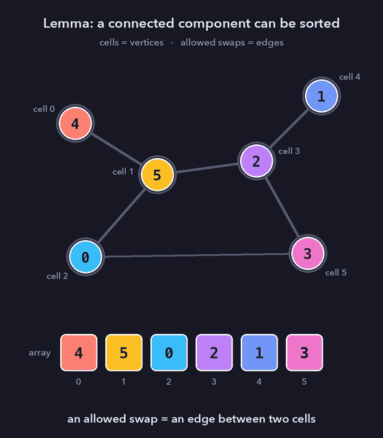
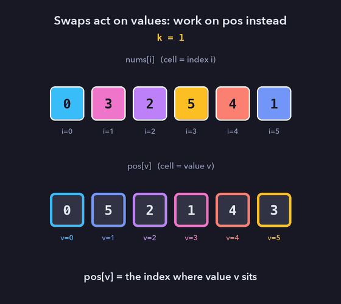
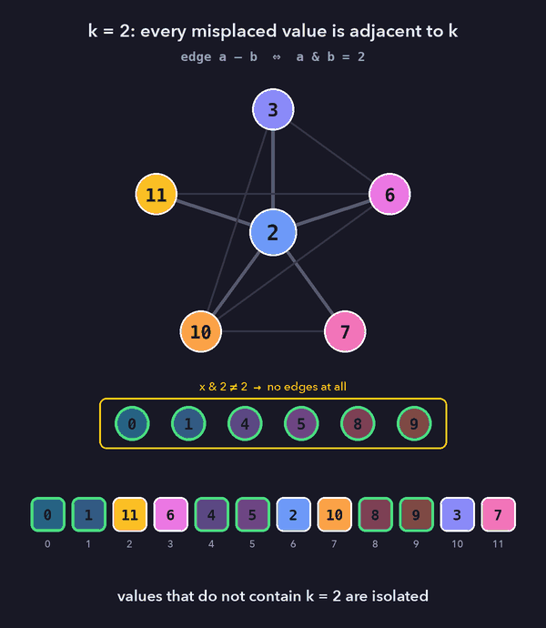
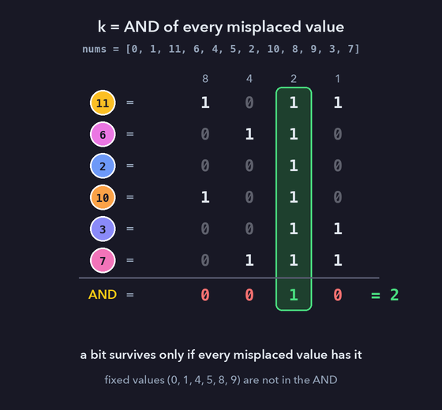

# Intuition
My first solution built $k$ bit by bit with a `check(k)` function, in $O(n \log n)$. It was slower than most submissions. Looking at what `check` actually tests showed that the answer is simply the AND of all misplaced values, which gives $O(n)$.

# Approach
Only some pairs of elements can be swapped, so it is natural to model the problem with a graph. The question then becomes whether every value can reach its correct position. We first look at this model in general, then adapt it to the swap rule of this problem.

### 1. Restricted swaps as a graph

Suppose only some pairs of cells may be swapped. Let $G$ be the graph whose vertices are the cells and whose edges are the allowed swaps. Let $P$ be the current arrangement, so that the value in cell $i$ has to end up in cell $P_i$.

**Lemma 1.** Let $C$ be a connected component of $G$. Any arrangement of the values currently in $C$ over the cells of $C$ can be reached by allowed swaps.

*Proof.* Induction on $|C|$. Fix a spanning tree $T$ of $C$; it suffices to use the edges of $T$. If $|C| \le 2$ the claim is immediate. Otherwise let $L$ be a leaf of $T$, and let $x$ be the value that should end up in $L$. Move $x$ along the path from its current cell to $L$ in $T$, swapping it with the next vertex at each step. Now $L$ holds its final value, and we never touch it again. $T - L$ is still a tree, since removing a leaf preserves connectivity, so by the induction hypothesis the remaining $|C| - 1$ cells can be arranged arbitrarily. $\blacksquare$



**Corollary.** The array can be sorted if and only if, for every $i$, the cells $i$ and $P_i$ lie in the same connected component of $G$.

Necessity holds because a value can only move along edges. Sufficiency follows from Lemma 1 applied to each component.

### 2. Passing to the inverse permutation

In this problem the swap condition depends on the **values** being swapped ($nums[i] \mathbin{\mathrm{AND}} nums[j] = k$), not on their indices, so Section 1 does not apply to `nums` directly. Let

$$pos[nums[i]] = i,$$

so that $pos[v]$ is the index of value $v$, i.e. $pos = nums^{-1}$. Swapping the values $a$ and $b$ in `nums` corresponds exactly to swapping the cells $a$ and $b$ in `pos`. Moreover `nums` is the identity if and only if `pos` is. On `pos` the condition is on cell indices, so the model of Section 1 applies to the graph

$$G_k = \big(\lbrace 0, \dots, n-1 \rbrace,\ \lbrace \lbrace a, b \rbrace : a \mathbin{\mathrm{AND}} b = k \rbrace\big),$$

and sorting is possible if and only if $v$ and $pos[v]$ are in the same component of $G_k$ for every $v$.



### 3. The structure of $G_k$

Call $v$ a *supermask* of $k$ if $v \mathbin{\mathrm{AND}} k = k$. Let $M = \lbrace  v : pos[v] \ne v  \rbrace$ be the set of misplaced values. Note that $pos[v] \ne v \iff nums[v] \ne v$.

**Lemma 2.** If $v$ is not a supermask of $k$, then $v$ is isolated in $G_k$.

*Proof.* For any $x$, the bits of $v \mathbin{\mathrm{AND}} x$ are a subset of the bits of $v$. If $v \mathbin{\mathrm{AND}} x = k$, then every bit of $k$ is a bit of $v$, which means $v \mathbin{\mathrm{AND}} k = k$. $\blacksquare$

**Lemma 3.** If $G_k$ has at least one supermask $v$ of $k$, then all supermasks of $k$ lie in one connected component.

*Proof.* A submask is never larger than its supermask, so $k \le v \le n-1$. Since the values are exactly $0, \dots, n-1$, $k$ is itself a vertex of $G_k$. Every supermask $u \ne k$ satisfies $u \mathbin{\mathrm{AND}} k = k$, so it is adjacent to $k$. Hence the supermasks contain a spanning star centred at $k$. $\blacksquare$

**Theorem.** $k$ is feasible if and only if every $v \in M$ is a supermask of $k$.

*Proof.* ($\Rightarrow$) By Lemma 2, a non-supermask $v$ is isolated, so it must already be in place, i.e. $v \notin M$.
($\Leftarrow$) $pos$ restricted to $M$ is a permutation of $M$, because fixed points can only be images of themselves. So for $v \in M$ both $v$ and $pos[v]$ lie in $M$, are supermasks of $k$, and by Lemma 3 lie in the same component. The Corollary of Section 1 finishes the proof. $\blacksquare$

The animation below sorts `nums = [0, 1, 11, 6, 4, 5, 2, 10, 8, 9, 3, 7]` with $k = 2$ using only edges incident to $k$, which is exactly the star from Lemma 3. Some other pairs of supermasks are also adjacent (e.g. $3 \mathbin{\mathrm{AND}} 6 = 2$), but the argument does not need them.



The Theorem is exactly what `check` computes:

```cpp
for (int i = 0; i < n; i++)
    if ((i & k) != k)       // i is isolated in G_k
        if (pos[i] != i)    // and misplaced
            return 0;
return 1;
```

### 4. Solution 1: greedy over bits, $O(n \log n)$

By the Theorem, the set of feasible $k$ is closed under taking submasks: if every $v \in M$ contains $k$, it also contains every submask of $k$. Therefore the greedy procedure that goes from the highest bit down, sets the bit, and keeps it only if `check` still holds, returns the maximum feasible $k$. Since $n \le 10^5 \lt 2^{17}$, 18 bits suffice.

On the example above, $M = \lbrace 11, 6, 2, 10, 3, 7 \rbrace$:

| candidate | binary | element of $M$ not containing it | kept |
|---|---|---|---|
| $2^{18}, \dots, 16$ | | all | no |
| 8 | `1000` | 6 | no |
| 4 | `0100` | 11 | no |
| 2 | `0010` | none | yes |
| 3 | `0011` | 6 | no |

### 5. Solution 2: the AND of the misplaced values, $O(n)$

By the Theorem, $k$ is feasible if and only if $k$ is a common submask of all elements of $M$, that is,

$$k \text{ is feasible} \iff k \subseteq \bigwedge_{v \in M} v .$$

So the set of feasible $k$ is exactly the set of submasks of $A = \bigwedge_{v \in M} v$. Its maximum, both as a mask and as an integer, is $A$ itself. Since $v \in M \iff nums[v] \ne v$, $A$ can be computed in one pass over `nums` without building `pos`.



On the given examples:
- `[0,3,2,1]`: $M = \lbrace 3, 1 \rbrace$, $A = 1$.
- `[0,1,3,2]`: $M = \lbrace 3, 2 \rbrace$, $A = 2$.
- `[3,2,1,0]`: $M = \lbrace 0, 1, 2, 3 \rbrace$, $A = 0$.

### Edge case ⚠️
If `nums` is already sorted, $M = \emptyset$ and every $k$ is feasible. The problem asks for $0$ in this case, so both solutions return early.

# Complexity
**Solution 1**
- Time complexity: $$O(n \log n)$$
one $O(n)$ `check` per bit, and the number of bits is $O(\log n)$ (the code uses the fixed bound 18).
- Space complexity: $$O(n)$$
for `pos`.

**Solution 2**
- Time complexity: $$O(n)$$
- Space complexity: $$O(1)$$

# Code
```cpp [Solution 1 - O(n log n)]
/**
 * this solution is O(n.lg(n))
 */
class Solution {
    const int LOG = 18;
public:
    int sortPermutation(vector<int>& nums) {
        if (std::is_sorted(nums.begin(), nums.end()))
            return 0;
        
        int n = nums.size();
        vector<int> pos(n);

        for (int i = 0; i < n; i++) 
            pos[nums[i]] = i;
        
        int ans = 0;
        for (int i = LOG; i >= 0; i--) {
            if (check(pos, ans^(1<<i)))
                ans ^= 1<<i;
        }

        return ans;
    }
private:
    bool check(const vector<int>& pos, int k) {
        int n = pos.size();
        for (int i = 0; i < n; i++) {
            if ((i&k) != k)
                if (pos[i] != i) 
                    return 0;
        }

        return 1;
    }
};
```
```cpp [Solution 2 - O(n)]
/**
 * This solution is O(n)
 */
class Solution {
    const int LOG = 18;
public:
    int sortPermutation(const vector<int>& nums) {
        if (std::is_sorted(nums.begin(), nums.end()))
            return 0;
            
        int n = nums.size();

        int ans = (1<<LOG)-1;
        for (int i = 0; i < n; i++) 
            if (nums[i] != i) 
                ans &= nums[i];

        return ans;
    }
};
```
