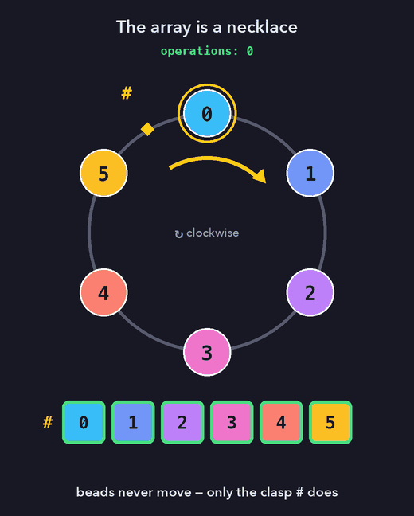

# 📿 Sort by Reverse & Rotate: the necklace view

My accepted solution to the LeetCode problem in [Problem.md](Problem.md).

The idea: treat the array as a **necklace** whose beads never move. *Rotate Left* slides the clasp `#` one bead forward, and *Reverse* flips the reading direction.

- [Solution.md](Solution.md): full write-up with animations
- [Solution.cpp](Solution.cpp): the C++ code
- [images/make_gifs.py](images/make_gifs.py): regenerates all the animations (`python3 images/make_gifs.py images`)
